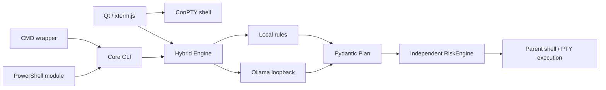

# Architecture and implementation decisions

## 0.5.1 native grounding

`Context` retains OS/architecture/locale, actual shell version/edition/executable,
language mode, administrator status, Known Folders, bounded directory evidence,
allowlisted environment values and caller functions/aliases. Command translation
selects relevant facts instead of dumping the environment or unrelated history.
PowerShell wrappers identify Core/5.1 correctly and transmit relevant function
names without bodies. GUI discovery runs in the request worker, off the event loop.

There are no task/answer examples in the command prompt. After selection, Windows
`help` or PowerShell command metadata provides native syntax. PowerShell's parser
and static parameter binder inspect proposals as data, without invoking them.
Known session object properties/enums come from reflection. Verified simple file
tasks additionally check operation family, literal operands, quotes and CMD arity.
Missing/ambiguous sources and creation conflicts remain application observations.

Incorrect candidates receive bounded corrective feedback (three command attempts
within the existing deadline). Valid, grounded simple tasks avoid an unnecessary
second inference; ungrounded choices can receive a native-reference review.
The model's actual parameter count selects the initial context budget: models
below one billion parameters start with a compact prompt, then receive full
runtime facts during reference review. Model selection is preserved; no silent
substitution with a larger model occurs. A truncated reply can be corrected, and
simple value constraints explicitly declared by native help are checked as data.
One whole-response code delimiter is normalized; prose/multiple lines fail.
Permissions and execution policy remain independent of model output. This is not
a proof of arbitrary shell equivalence or a replacement for model capacity.

API references: [PowerShell parsing](https://learn.microsoft.com/en-us/powershell/module/microsoft.powershell.core/about/about_parsing),
[static binding](https://learn.microsoft.com/en-us/dotnet/api/system.management.automation.language.staticparameterbinder.bindcommand),
[Ollama chat](https://docs.ollama.com/api/chat).

## 0.5.0 generation and UI

The default Ollama path generates one plain shell command, not a JSON envelope.
The app validates it and wraps it into a typed `Plan` with a `command` action and
trusted transport trace. Format/executable/source mistakes get one corrective
retry. The previous constrained-schema planner remains selectable in Settings.
Its inspection tools also check the selected read permission before accessing data.

Access profiles are defined by `SafetyConfig`, checked by `safety/permissions.py`
and applied consistently in CLI/GUI and the typed file helper. Full access removes
application policy blocks/confirmations; Developer retains confirmation. Arbitrary
scripts need all effect permissions; this does not implement an OS sandbox.

The native Qt layout uses a PySide6 adapter over two complete MIT PyGlass modules:
`effect.py` and `refract.py`, pinned at c12d91f1526badbe18f619ff893d2cdbbd86dac5.
No desktop capture code is shipped. Backdrops are app-owned gradients; refraction
kernels are resolution bounded and cached after resize, while hover animation uses
the upstream compositor. NumPy is bundled in the shared runtime.

The sections below describe the original structured planner and conservative
profile; permanent-block statements there do not apply to Developer/Full profiles.

## Boundaries

Core, providers, typed schema, configuration and policy do not call Windows APIs. `PlatformAdapter`, `ShellAdapter`, `PtyBackend` define replacement boundaries. Windows lives under `platform/windows`; Linux is deliberately not implemented.

## Research, verified 2026-10-10

| Subject | Decision / official source |
|---|---|
| Parent shell | A child cannot change its parent cwd. CMD calls a batch action in the current interpreter. [Microsoft CALL](https://learn.microsoft.com/en-us/windows-server/administration/windows-commands/call) |
| PowerShell | Use a module function importing a structured plan. Add one marked block to CurrentUserAllHosts, preserving existing bytes and backups. Discover `$PROFILE` in each installed shell. [Profiles](https://learn.microsoft.com/en-us/powershell/module/microsoft.powershell.core/about/about_profiles) |
| PTY | pywinpty 3.0.3 explicitly selects native ConPTY, not legacy winpty. One shell process per window; blocking reads run on a dedicated thread. [pywinpty](https://github.com/andfoy/pywinpty), [ConPTY lifecycle](https://learn.microsoft.com/en-us/windows/console/creating-a-pseudoconsole-session) |
| Renderer | xterm.js 5.5.0 with Fit/WebLinks addons vendored from pinned npm dependencies. QWebEngine/QWebChannel local files only. [xterm security](https://xtermjs.org/docs/guides/security/), [Qt WebChannel](https://doc.qt.io/qtforpython-6/PySide6/QtWebChannel/QWebChannel.html) |
| Prompt markers | OSC title (`0`) carrying a random per-window token and cwd, emitted after the prompt. ConPTY reliably carries this supported OSC. Unknown custom OSC sequences can be dropped by the Windows console. [Windows VT](https://learn.microsoft.com/en-us/windows/console/console-virtual-terminal-sequences) |
| Structured output | Pass Pydantic JSON Schema to `/api/chat.format`, temperature 0, `think:false`, bounded context, one retry on invalid schema. [Ollama structured output](https://docs.ollama.com/capabilities/structured-outputs) |
| Model | Exact requested default `qwen3:4b-instruct`, official tag approx. 2.5 GB Q4_K_M. No silent tag substitution. [Ollama model](https://ollama.com/library/qwen3:4b-instruct) |

## Typed actions instead of unvalidated strings

In 0.3.0, `inspect` plans expose read-only read/list/find/processes tools for questions about actual files. Engine executes bounded observations in the current/known directories, then calls Qwen again with structured, redacted evidence. The answer phase allows explain/clarify/error and removes action fields, preventing repeated inspection rounds. Tool results and file contents remain untrusted data. Trace metadata comes from the actual Ollama response, never the model-authored plan. `--model` or the GUI route selector can bypass concrete local rules; the independent risk check and confirmation still apply.

Plans contain `actions`, rather than treating a list of free-form commands as authoritative. Navigation, file queries (size, date, pattern and file type), process RAM queries, reading, deletion, clearing and environment changes have typed fields. Quoting happens in the shell adapter. Complex filesystem/process queries invoke Chameleon's trusted read-only query helper using an ASCII base64 JSON argument, so CMD does not need an AI-generated nested interpreter. A `command` escape hatch remains subject to a conservative independent allowlist and confirmation. Opaque interpreters/downloads/storage destruction are blocked. This deliberately uses a more restrictive schema than the conceptual example to make paths/data distinguishable from executable syntax.

The generation schema requires the full plan envelope, fixes the target shell and exposes only relevant fields for each action kind. Clearly worded file searches use a file-query grammar; Qwen still interprets their pattern, path, size and date constraints. This avoids the 4B model dropping optional filters or substituting a process operation for a file search. Invalid output gets one corrective retry including validation errors, and is never executed.

Model context removes terminal escape sequences, caps visible recent output at 600 characters and includes only relevant executable paths. This bounds privacy exposure and CPU prompt-processing latency. General language preference is reserved for future UI translation; the initial UI uses Spanish with conventional terminal labels, while natural requests support Spanish and English now.

## Input and interactive programs

All editing keys go to the real shell. On Enter, xterm reads the complete rendered shell line using public buffer APIs. If an authenticated prompt marker is active, the bridge classifies the line; known commands go to ConPTY immediately. Natural input is held while local rules or Ollama plan it. Generated commands are inserted into the same shell after clearing its editable line; input echo is suppressed until its completion boundary. A marker is inactive after Enter until the real shell emits another prompt, so REPL/SSH/TUI input stays raw. Multiline paste always stays raw. Shell aliases/functions/cmdlets are discovered inside PowerShell's prompt. A user who changes/removes the child prompt marker gets a raw terminal until starting a new session.

## Threading and shutdown

PTY reader and AI workers do not call widgets. Qt signals marshal results to the UI thread. Async HTTP has timeout and cancellation. Ctrl+C while inference is running cancels its task and returns the shell prompt. Shutdown terminates child processes before the shell, cancels PTY IO and bounds reader joining. QWebEngine prevents automatic remote navigation and network access from local content. Explicit clicked hyperlinks can open the user's browser.

## Distribution and updates

PyInstaller onedir shares Qt/Python among console Core and windowed Terminal/Setup. A small standard-library bootstrap embeds the release ZIP and starts the full PySide Setup from a random temporary directory. This avoids duplicating Qt inside the installer and supports repair without holding installed DLLs open. Setup can be run again with a newer release for Update. Version is semantic `0.6.0`; no update server or background downloader exists. Releases can add signing without changing core interfaces.

The build limits dependency scanning to Windows and the Python runtime paths, preventing unrelated developer-tool ICU/API shim DLLs from entering Qt's runtime. Before spawning native shells or external programs, Windows temporarily restores the normal DLL search path and removes bundled paths from the child environment, then restores the parent runtime immediately after creation. See [PyInstaller external programs](https://pyinstaller.org/en/stable/common-issues-and-pitfalls.html#launching-external-programs-from-the-frozen-application).

pywinpty's side-by-side `conpty.dll` requires its matching `OpenConsole.exe` from the published wheel. The spec explicitly bundles that host because dependency scanning only discovers linked DLLs. Frozen smoke tests catch a missing host by requiring actual shell output, navigation and direct commands. The backend argument uses a nonempty representation of ConPTY's zero constant to prevent pywinpty's environment fallback from selecting legacy WinPTY.

## Native interface and motion (0.6.0)

The forest palette separates opaque terminal content and matte configuration surfaces from cached optical glass action bars. PyGlass dispersion glow is disabled; the environment lighting is neutral/green. Lens dimensions scale with the capped cache resolution. Pointer lighting is painted over the cached image without recomputing optical kernels on every hover.

`ui/controls.py` adapts Codrops magnetic interpolation and Motion Primitives pointer spotlight to native Qt painting. Only painted content moves: hit regions and layouts remain stable. Timers stop at rest, hide and disable. `ui/motion.py` reads Windows client-area animation preference; `CHAMELEON_REDUCED_MOTION=1` provides a diagnostic override. No browser framework runtime is added.

The terminal inspector overlays its viewport, so opening it never resizes ConPTY. Closing restores xterm focus. Setup progressively discloses advanced options/logs and distinguishes fresh install, version update and opening an existing current installation. Custom capability switches appear only for the Custom access preset; backend policy remains unchanged.
